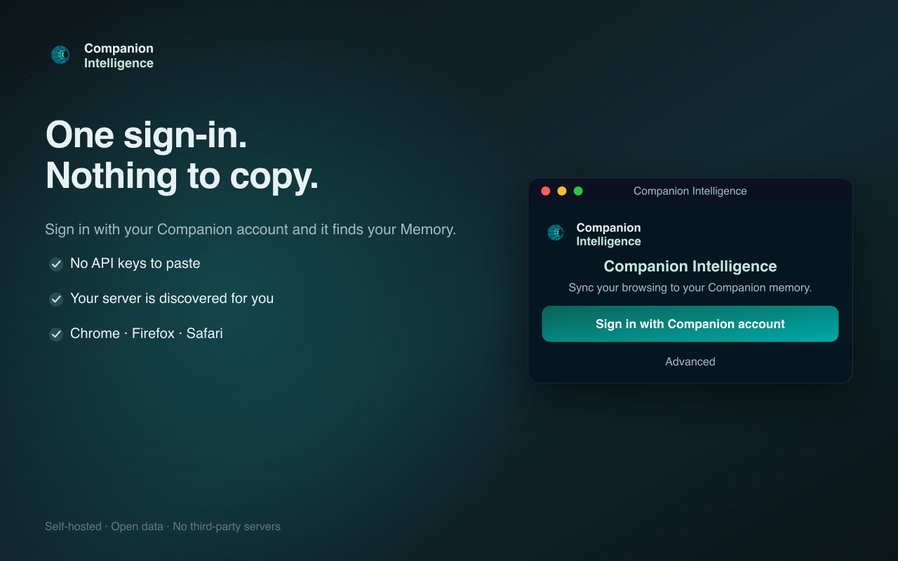
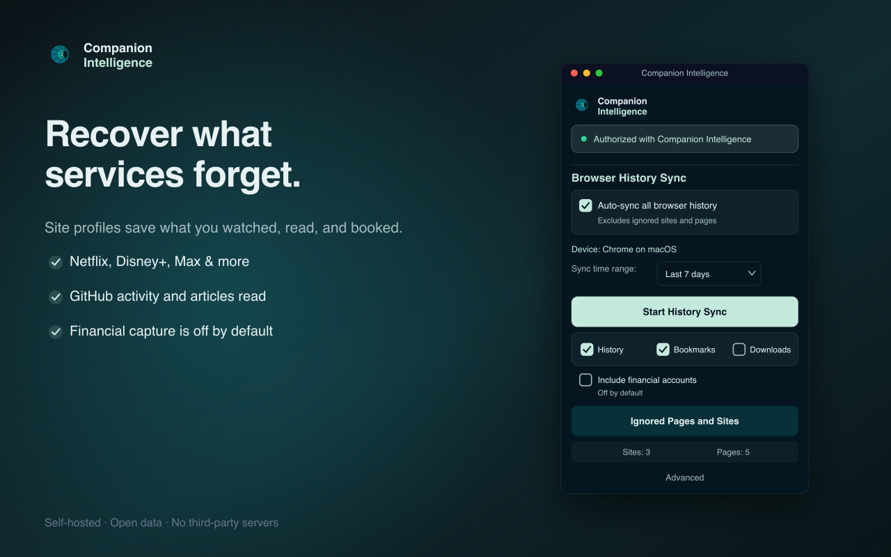

<div align="center">


<h1 align="center">Companion Intelligence Browser Extension</h1>

<p align="center"><strong>Your browsing, your private memory.</strong></p>

<p align="center"><a href="#installation">Get started</a></p>

A privacy-first browser extension that syncs your history, bookmarks, downloads,
and highlights to a **Companion Intelligence (CI) Server that you control** —
never the cloud.

`v1.4.0` · Chrome · Firefox · Safari · WXT + TypeScript

> [PolyForm Noncommercial 1.0.0](LICENSE.md) · [License FAQ](License-FAQ.md) · © LifeScope INC, DBA Companion Intelligence


</div>

## 🌟 Overview

The extension is a personal web-archival tool. It records **your own** browsing
activity and sends it to your private CI Server, building a searchable digital
memory of your online life. Lifescope never receives your captured data, and
there are no third-party trackers. (Signing in uses Lifescope's identity service,
CI-Portal, which necessarily learns who you are — but never what you capture.
You can point the extension at your own Portal under **Advanced**.)

## ✨ Features

- **History sync** — sync your browsing history (URL, title, visit time, dwell,
  scroll depth, page description) to your CI Server, over a time range you pick.
- **Bookmarks & downloads** — keep them in sync too; each data type toggles
  independently.
- **Highlight-to-save** — select text on any page and archive it via the context
  menu.
- **Ignored Pages and Sites** — exclude any site or page from capture in one
  click. Nothing on your ignore list is ever uploaded.
- **Supported-site profiles** — structured capture from 13 sites: Netflix, Hulu,
  Disney+, Max, Paramount+, Prime Video (incl. `amazon.com/gp/video`), CNN, WSJ,
  Slashdot, GitHub, Quora, Airbnb, and Robinhood — each only on the specific
  pages it was written for. Robinhood is **off unless you opt in**. See
  [`CAPTURE.md`](CAPTURE.md).
- **Reliable background sync** — uses the `chrome.alarms` lifecycle so scheduled
  work survives MV3 service-worker suspension.
- **Self-hosted & token-secured** — point it at any CI Server domain; auth is a
  standard CI-Portal OIDC (Authorization-Code + PKCE) login that yields a
  short-lived portal `id_token`.

See [`CAPTURE.md`](CAPTURE.md) for exactly what is captured (and what never is),
the site-profile list and roadmap, [`PRIVACY.md`](PRIVACY.md) for the full
data-handling disclosure, and [`CHANGELOG.md`](CHANGELOG.md) for release notes.

## 📸 Screenshots

| Sync to your server | Pick what's captured | Keep private sites private |
|---|---|---|
|  |  |  |

| One sign-in | Recover what services forget |
|---|---|
|  |  |

## 🚀 Installation

### For users
Store listings are prepared for the Chrome Web Store, Firefox Add-ons, and the
Apple App Store (Safari). See [`store-assets/STORE-LISTING.md`](store-assets/STORE-LISTING.md)
and [`PUBLISHING.md`](PUBLISHING.md).

### For developers (manual install)

```bash
corepack enable          # the repo pins yarn 4 via packageManager
yarn install
yarn build               # Chrome MV3  → .output/chrome-mv3
yarn build:firefox       # Firefox MV2 → .output/firefox-mv2
```

- **Chrome / Edge / Brave**: `chrome://extensions` → enable Developer mode →
  **Load unpacked** → select `.output/chrome-mv3`.
- **Firefox**: `about:debugging` → This Firefox → **Load Temporary Add-on** →
  select `.output/firefox-mv2/manifest.json`.
- **Safari**: no unpacked-load mode — `yarn build:safari` produces
  `.output/safari-mv2`, which must be wrapped in an Xcode project via
  `xcrun safari-web-extension-converter` before it can run. See
  [`DEVELOPMENT.md`](DEVELOPMENT.md#safari) for local testing and
  [`PUBLISHING.md`](PUBLISHING.md#apple-app-store-safari) for the release flow.

> **Package manager:** this repo uses **yarn 4** (via corepack). It cannot be
> installed with npm/pnpm because the workspace uses the `workspace:*` protocol.

## 📖 Usage

1. Open the popup and click **Sign in with Companion account** — this opens the
   CI-Portal OIDC login (PKCE) against the production Portal (`hub.ci.computer`).
   For dev work, the small **Advanced** link on the logged-out view switches the
   Portal (staging / dev / local presets, or a custom URL).
2. After sign-in the extension asks the Portal where your **Memory** app runs
   and configures the server URL automatically. If Memory is installed on more
   than one of your devices, the popup asks which device's Memory to use. If
   your account has no Memory app yet, the popup says so and offers **Check
   again**, **Open Portal**, or manual URL entry. You can re-run discovery any
   time from **Settings → Find my Memory** to switch devices. If your Portal
   doesn't support discovery (or you run an unusual setup), set the
   **Memory URL** manually under **Settings**. Once signed in, the popup
   shows the connected Memory host and your device.
3. Choose a **sync time range** and click **Start History Sync**, or enable
   **Auto-sync** to run in the background.
4. Toggle **History / Bookmarks / Downloads** to control what's captured.
5. Use **Ignored Pages and Sites** to exclude anything private.

## 🛠️ Development

```bash
yarn dev                 # Chrome dev server (also dev:firefox, dev:edge, …)
yarn test                # Jest unit tests
yarn compile             # tsc --noEmit
yarn lint                # eslint
yarn build:firefox       # per-browser builds; see package.json scripts
yarn prepare:store       # clean + zip all store targets into .output/
```

### Project structure

```
src/
├── entrypoints/
│   ├── background.ts            # sync engine, auth, alarms, device setup
│   ├── content.ts              # scroll depth + page metadata (reports on request)
│   ├── domainScraper.content.ts # supported-site capture
│   └── popup/                  # popup UI (App.tsx, BlacklistManager.tsx)
├── lib/                        # capture queue, ignore filter, validation
├── scrape/                     # profile registry + scrape engine
├── scrapeProfiles/             # per-site scrape profile JSON
├── services/                   # OIDC auth, portal discovery, ingest transport
├── store/                      # Redux Toolkit + webext-redux
└── utils.ts                    # URL parsing, ignore-list matching
store-assets/                   # store + README art (regenerate via render.sh)
```

## 🏗️ Architecture

- **Framework:** [WXT](https://wxt.dev) (cross-browser, type-safe)
- **UI:** React 19 + TypeScript + Tailwind/shadcn
- **State:** Redux Toolkit + `webext-redux` (shared across popup/background)
- **Storage:** `browser.storage.local` — settings, synced-ID bookkeeping, and a
  bounded retry queue for live captures that fail to upload
- **HTTP:** posts captures to your CI Server's typed bulk lanes —
  `POST /api/v1/browser-activity` (visits, downloads) and
  `POST /api/v1/contents` (bookmarks, highlights, scraped items) — then
  `POST /api/v1/ingest/finish` so what was written becomes searchable; device
  registration via `/api/devices`

**Browser builds:** Chrome MV3 (primary), Firefox MV2, Safari MV2 (desktop) /
MV3 (iOS via `build:safari-mobile`), plus Edge/Opera/Brave/DuckDuckGo
(Chromium, identical manifest). `yarn build:<target>`.

### Data flow
1. Navigation events and manual/auto sync collect activity (minus your ignore lists).
2. Items are de-duplicated against local sync bookkeeping.
3. Batches POST to your CI Server's `/api/v1/browser-activity` and
   `/api/v1/contents` with the portal `id_token` as the Bearer. Ignore-list rules
   are applied to every capture path here, at the transport; the server dedups
   on `(source_type, source_system, source_id)`.
4. A `POST /api/v1/ingest/finish` sweep indexes the batch — the bulk lanes write
   without indexing, so this is what makes captures searchable.
5. A live capture whose upload fails (offline, server down) is queued locally and
   retried at the start of the next sync — automatic or manual — rather than
   being dropped.
6. Page title/description come from the page itself (a content-script read) — no
   third-party metadata service.

**Requires** CI-Server to run with `PORTAL_OIDC_ENABLED=true`; otherwise it
rejects portal tokens with a bare 401.

### Security & privacy
- Data is sent only to **your** configured CI Server; no third-party analytics.
- Auth: a CI-Portal OIDC Authorization-Code + PKCE login (public client
  `ci-browser-extension`). The extension sends the portal-issued, JWKS-signed
  `id_token` as the Bearer to CI-Server's `/api/v1/*` bulk routes; no passwords,
  session cookies, or CSRF tokens are read or stored. (Replaces the retired
  cookie/CSRF/`/api/authenticate/refresh` flow.)
- No passwords or form contents are collected. See [`PRIVACY.md`](PRIVACY.md).

## 🗺️ Roadmap

Tracked in `CI-Engineering/projects/ci-browser-extension`. Highlights: a
diagnostics panel, broader scrape-profile coverage, a server-side fan-out
contract so scrapes stop riding the page-view lane, and Browser-Use
bidirectional control. The extension already authenticates through the
platform's **CI-Portal OIDC** identity provider (Authorization-Code + PKCE).

## 🤝 Contributing

TypeScript, ESLint, Prettier, and WXT. Run `yarn lint && yarn compile && yarn test`
before pushing. CI (GitHub Actions) runs lint/type/test/build on every PR.

## 🆘 Support

support@ci.computer — and check the popup status, your CI Server connectivity,
and the browser console for diagnostics.
