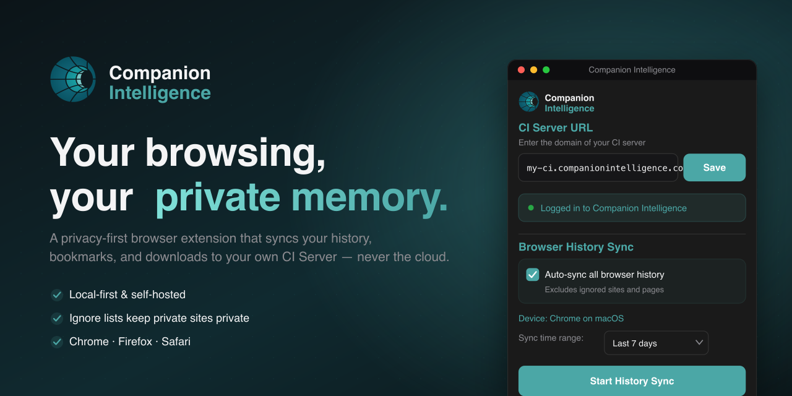
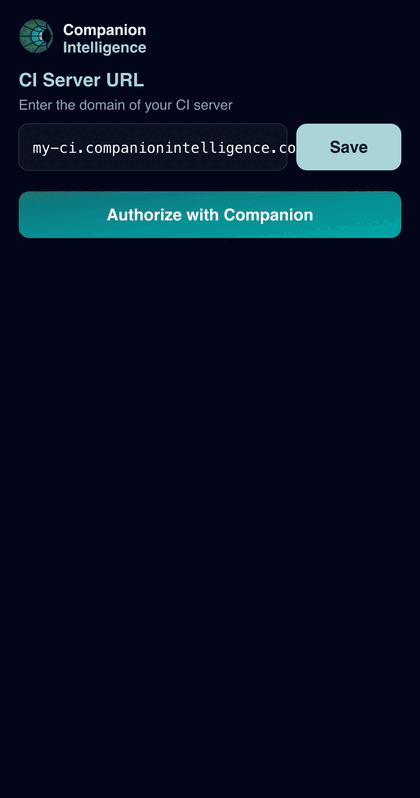
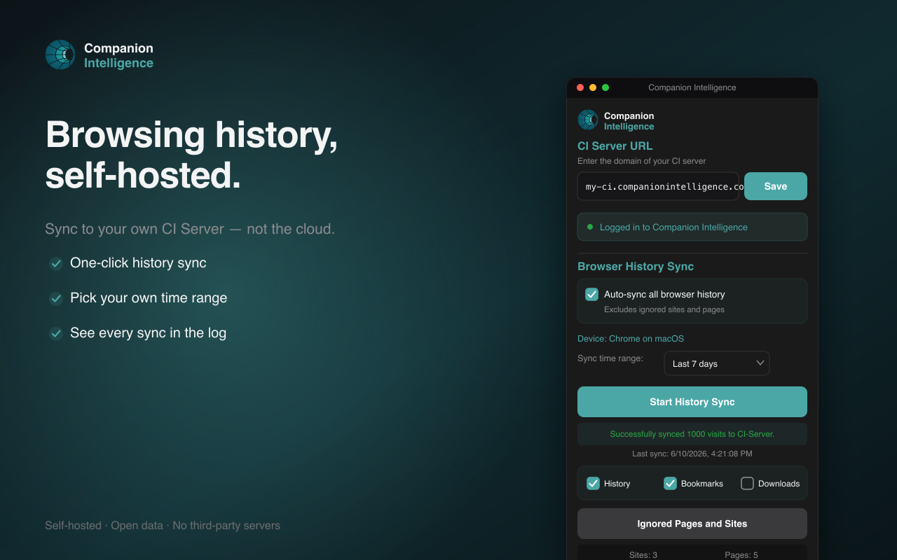
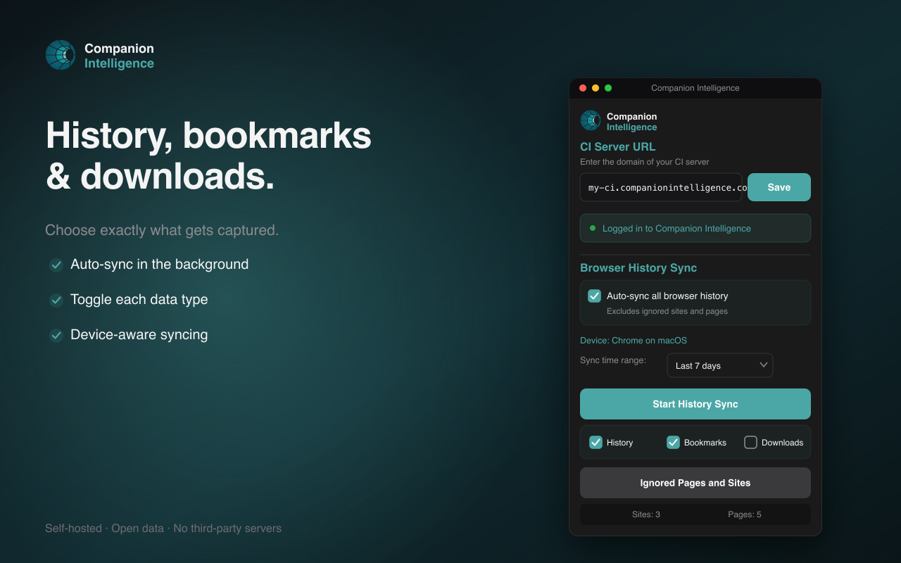
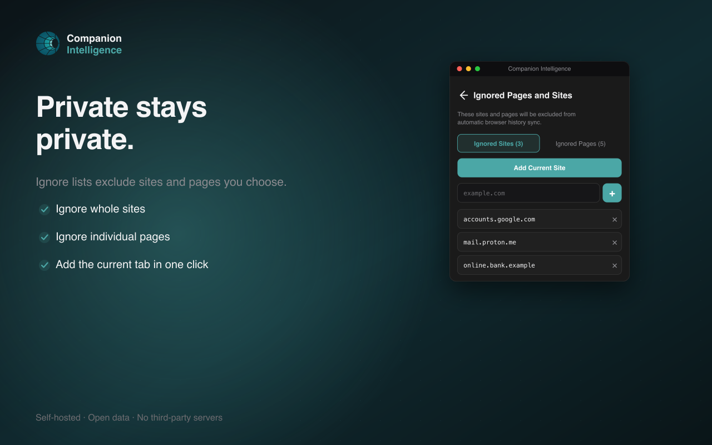

<div align="center">



# Companion Intelligence Browser Extension

**Your browsing, your private memory.**
A privacy-first browser extension that syncs your history, bookmarks, downloads,
and highlights to a **Companion Intelligence (CI) Server that you control** —
never the cloud.

`v1.4.0` · Chrome · Firefox · Safari · WXT + TypeScript

> #### PRIVATE AND CONFIDENTIAL — PROPERTY OF LIFESCOPE INC.



</div>

## 🌟 Overview

The extension is a personal web-archival tool. It records **your own** browsing
activity and sends it to your private CI Server, building a searchable digital
memory of your online life. Lifescope never receives your data, and there are no
third-party trackers.

## ✨ Features

- **History sync** — sync your browsing history (URL, title, visit time, dwell,
  scroll depth, page description) to your CI Server, over a time range you pick.
- **Bookmarks & downloads** — keep them in sync too; each data type toggles
  independently.
- **Highlight-to-save** — select text on any page and archive it via the context
  menu.
- **Ignored Pages and Sites** — exclude any site or page from capture in one
  click. Nothing on your ignore list is ever uploaded.
- **Supported-site profiles** — structured capture (e.g. watchlists) on Netflix,
  Hulu, Disney+, Max, Paramount+, Prime Video, GitHub, and Slashdot — only on
  those domains.
- **Reliable background sync** — uses the `chrome.alarms` lifecycle so scheduled
  work survives MV3 service-worker suspension.
- **Self-hosted & token-secured** — point it at any CI Server domain; auth uses
  the server's session cookie + short-lived access tokens.

See [`PRIVACY.md`](PRIVACY.md) for the full data-handling disclosure and
[`CHANGELOG.md`](CHANGELOG.md) for release notes.

## 📸 Screenshots

| Sync to your server | Pick what's captured | Keep private sites private |
|---|---|---|
|  |  |  |

## 🚀 Installation

### For users
Store listings are prepared for the Chrome Web Store, Firefox Add-ons, and the
Apple App Store (Safari). See [`store-assets/STORE-LISTING.md`](store-assets/STORE-LISTING.md)
and [`PUBLISHING.md`](PUBLISHING.md).

### For developers (manual install)

```bash
corepack enable          # the repo pins yarn 4 via packageManager
yarn install
yarn build               # Chrome MV3  → .output/chrome-mv3
yarn build:firefox       # Firefox MV2 → .output/firefox-mv2
```

- **Chrome / Edge / Brave**: `chrome://extensions` → enable Developer mode →
  **Load unpacked** → select `.output/chrome-mv3`.
- **Firefox**: `about:debugging` → This Firefox → **Load Temporary Add-on** →
  select `.output/firefox-mv2/manifest.json`.

> **Package manager:** this repo uses **yarn 4** (via corepack). It cannot be
> installed with npm/pnpm because the workspace uses the `workspace:*` protocol.

## 📖 Usage

1. Open the popup and enter your **CI Server URL** (e.g. `my-ci.example.com`),
   then **Save**.
2. Click **Log in to continue** — this opens your CI Server's web login. Once
   signed in, the popup shows **Logged in** and your device.
3. Choose a **sync time range** and click **Start History Sync**, or enable
   **Auto-sync** to run in the background.
4. Toggle **History / Bookmarks / Downloads** to control what's captured.
5. Use **Ignored Pages and Sites** to exclude anything private.

## 🛠️ Development

```bash
yarn dev                 # Chrome dev server (also dev:firefox, dev:edge, …)
yarn test                # Jest unit tests
yarn compile             # tsc --noEmit
yarn lint                # eslint
yarn build:firefox       # per-browser builds; see package.json scripts
yarn prepare:store       # clean + zip all store targets into .output/
```

### Project structure

```
src/
├── entrypoints/
│   ├── background.ts            # sync engine, auth, alarms, device setup
│   ├── content.ts              # scroll depth + page metadata + highlight save
│   ├── domainScraper.content.ts # supported-site capture
│   └── popup/                  # popup UI (App.tsx, BlacklistManager.tsx)
├── scrapeProfiles/             # per-site scrape profile JSON
├── store/                      # Redux Toolkit + webext-redux
├── indexeddb.ts                # local queue
└── utils.ts                    # URL parsing, ignore-list matching
store-assets/                   # store + README art (regenerate via render.sh)
```

## 🏗️ Architecture

- **Framework:** [WXT](https://wxt.dev) (cross-browser, type-safe)
- **UI:** React 19 + TypeScript + Tailwind/shadcn
- **State:** Redux Toolkit + `webext-redux` (shared across popup/background)
- **Storage:** IndexedDB queue + `browser.storage.local`
- **HTTP:** Axios to your CI Server's `/api/browser-activity` and `/api/devices`

**Browser builds:** Chrome MV3 (primary), Firefox MV2, Safari MV3, plus
Edge/Opera/Brave/DuckDuckGo (Chromium, identical manifest). `yarn build:<target>`.

### Data flow
1. Navigation events and manual/auto sync collect activity (minus your ignore lists).
2. Items are de-duplicated against local sync bookkeeping.
3. Batches POST to your CI Server with a short-lived bearer token.
4. Page title/description come from the page itself (a content-script read) — no
   third-party metadata service.

### Security & privacy
- Data is sent only to **your** configured CI Server; no third-party analytics.
- Auth: the CI Server's `sessionToken`/`csrfToken` cookies (read on that domain
  only) → `POST /api/authenticate/refresh` → short-lived access token.
- No passwords or form contents are collected. See [`PRIVACY.md`](PRIVACY.md).

## 🗺️ Roadmap

Tracked in `CI-Engineering/projects/ci-browser-extension`. Highlights: local-first
outbox/queue, diagnostics panel and setup wizard, broader scrape-profile coverage,
participation in platform **SSO once CI-Server federates to the CI-Portal OIDC
identity provider** (the extension will continue to ride CI-Server sessions —
see the OIDC/SSO audit), and Browser-Use bidirectional control.

## 🤝 Contributing

TypeScript, ESLint, Prettier, and WXT. Run `yarn lint && yarn compile && yarn test`
before pushing. CI (GitHub Actions) runs lint/type/test/build on every PR.

## 🆘 Support

support@ci.computer — and check the popup status, your CI Server connectivity,
and the browser console for diagnostics.
